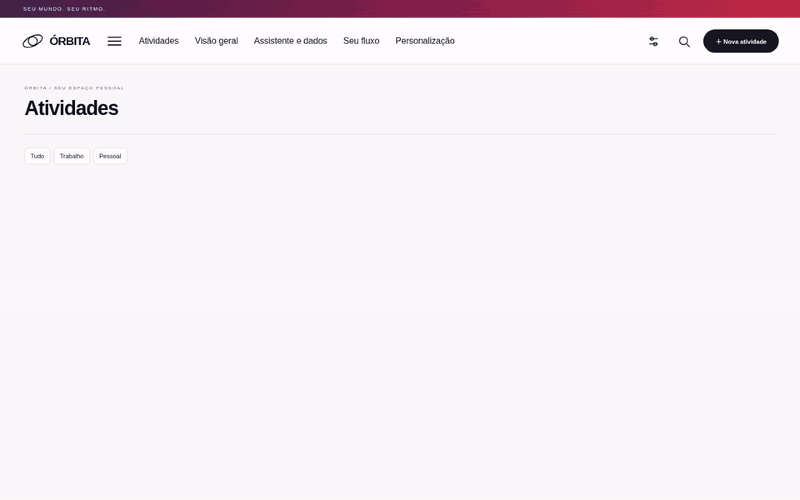

# Órbita — em movimento

Controle local de demandas com dashboard, tabela editável, cartões, calendário e opções personalizáveis.

**[Baixar a versão atual](https://github.com/juniircolt-lab/PBI/raw/refs/heads/main/Orbita.zip)**

Extraia o ZIP inteiro, abra a pasta **Orbita** e dê dois cliques em **index.html** no Chrome ou Edge. Antes de trocar uma versão anterior, exporte um backup completo. Importe esse backup na nova versão em **Assistente e dados**.

## Veja o movimento

Gravação real do navegador de testes: menu, troca de páginas e visualizações.

[Vídeo completo](Orbita/validacao/navegacao.webm) · [Dashboard](Orbita/validacao/dashboard-desktop.png) · [Menu](Orbita/validacao/menu-desktop.png) · [Relatório de testes](Orbita/validacao/RELATORIO.md)

## Nesta versão

- Cabeçalho horizontal e menu expansível com categorias amplas e painéis visuais.
- Cenário escuro/violeta, escultura orbital original e movimento suave com cursor e rolagem.
- Transições reais entre páginas e entre tabela, cartões e calendário, com alternativa para navegadores sem View Transitions.
- Navegação por teclado, Escape, adaptação à tela estreita e respeito à preferência por movimento reduzido.
- **+** junto dos campos da tabela e nos cartões para criar status, áreas, projetos e prioridades.
- **Seu fluxo** permite renomear opções, mudar cores e comportamento dos status e remover opções livres.
- Categorias personalizadas seguem no backup. Backups antigos continuam importáveis; backups com novas categorias devem ser usados nesta versão ou posterior.

O aplicativo funciona sem dependências externas. Os dados ficam no navegador ou em pasta conectada por você. Não há sincronização com GitHub, Google Drive ou servidor. 47 grupos de testes passaram em Chromium; os limites da validação estão no relatório.
